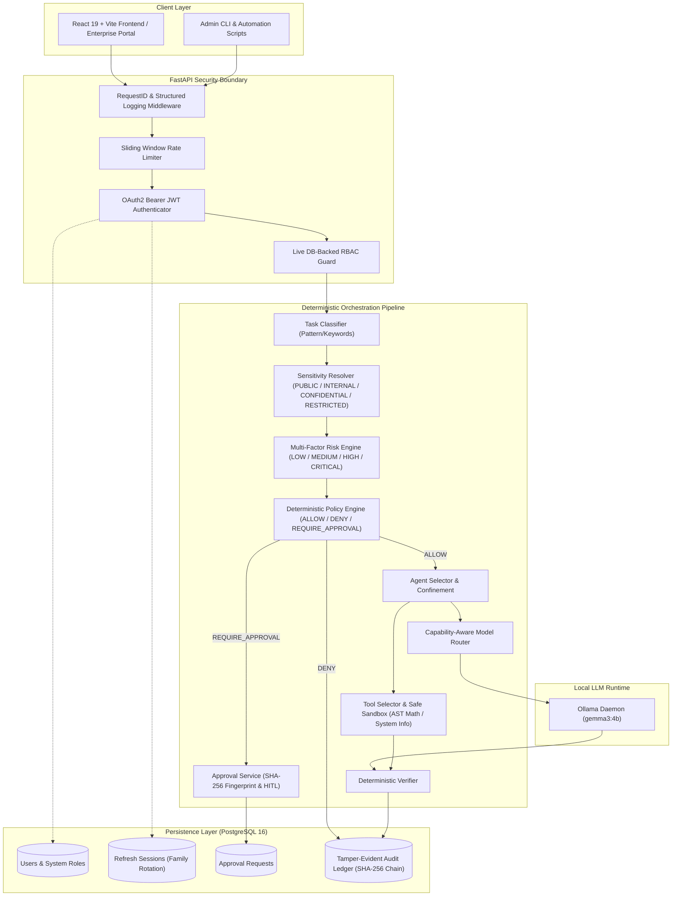
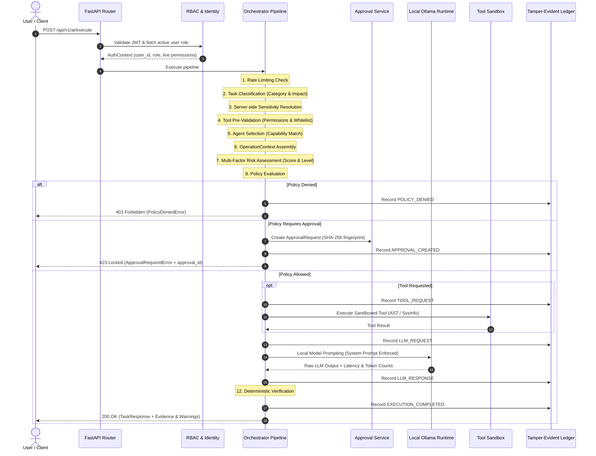
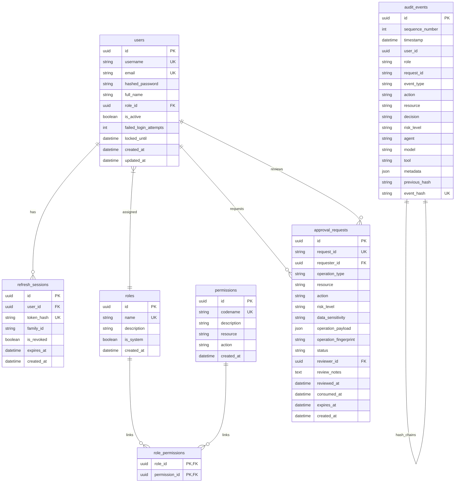
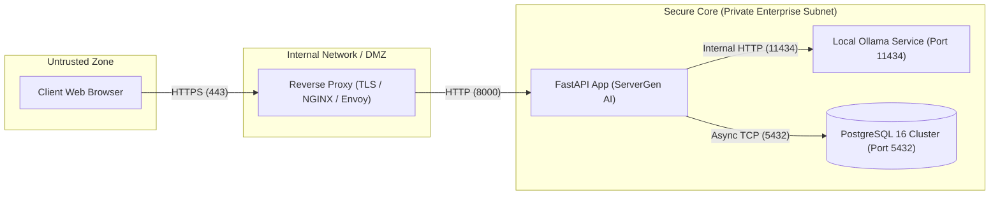

# ServerGen AI — Architecture Specification

> **Classification**: CONFIDENTIAL / ENTERPRISE SPECIFICATION  
> **Status**: APPROVED  
> **Target Deployments**: On-premise air-gapped environments, PSUs, refineries, defence-linked manufacturing, and sovereign infrastructure.

---

## 1. Executive Summary & Purpose

**ServerGen AI** is an enterprise-grade, self-hosted AI workbench designed to provide intelligent assistance over confidential internal knowledge and sensitive operational workflows without data leakage, unvetted agent autonomy, or reliance on third-party cloud APIs.

### Core Architectural Pillars
1. **Local & Private Execution**: All LLM inference occurs on-premise using Ollama (with support for vLLM and OpenAI-compatible on-prem endpoints) running lightweight, high-efficiency models (e.g., Gemma 3 4B).
2. **Zero-Trust Towards AI Outputs**: The LLM is strictly treated as an untrusted advisory component. LLM self-reported "confidence" is discarded. The model is NEVER permitted to decide authorization, evaluate data sensitivity, choose risk classifications, or execute OS/SQL/network commands directly.
3. **Deterministic Security Pipeline**: Authorization, risk evaluation, and policy enforcement are executed exclusively by deterministic Python algorithms prior to invoking any model or tool.
4. **Mandatory Human-in-the-Loop (HITL)**: Risky operations (HIGH or CRITICAL risk) trigger a cryptographic approval lifecycle requiring explicit four-eyes authorization before execution.
5. **Tamper-Evident Ledger**: Every authentication attempt, policy evaluation, approval transition, and AI inference is committed to a continuous SHA-256 hash-chained audit ledger serialized using PostgreSQL advisory locks.

---

## 2. High-Level System Architecture

The following diagram illustrates the component architecture and data boundaries:

---

## 3. 13-Step Deterministic Execution Pipeline

Every request to `/api/v1/ai/execute` traverses an immutable 13-step sequence:

### Detailed Pipeline Stages

#### 1. Rate Limiting Check
- Sliding-window in-memory rate limiter per `user_id` and action category (`LLM`, `LOGIN`, `API`, `TOOL`).
- Fails fast with `429 Too Many Requests` when thresholds are breached.

#### 2. Task Classification
- Deterministic heuristic analysis examining prompts for operational keywords, destructive markers (`delete`, `drop`, `restart`, `shutdown`), and query categories (`GENERAL`, `KNOWLEDGE`, `OPERATIONS`, `SECURITY`, `REPORTING`).
- Labels `production_affecting` flags strictly through code patterns.

#### 3. Server-Side Sensitivity Resolution
- Resolved across 4 levels: `PUBLIC`, `INTERNAL`, `CONFIDENTIAL`, `RESTRICTED`.
- The user may declare a sensitivity, but the server inspects the prompt (regex detection for API keys, passwords, credentials, PII) and can only **escalate**, never downgrade, data sensitivity.

#### 4. Tool Pre-Validation
- Validates the requested tool against `ToolRegistry`.
- Verifies tool exists and resolves the tool's `required_permission` (e.g., `system.read`, `tool.execute`). Unknown tools trigger an immediate `TOOL_BLOCKED` audit log and raise `ToolNotFoundError`.

#### 5. Agent Selection
- Maps `TaskCategory` and `OperationType` to one of 5 system agents:
  - `GeneralAgent`: General queries.
  - `KnowledgeAgent`: Document analysis (Module 3 stub).
  - `OperationsAgent`: Operational guidance; strictly advisory (Module 4 stub).
  - `SecurityAgent`: Security inspection; strictly advisory (Module 5 stub).
  - `ReportingAgent`: Executive summaries; strictly advisory (Module 6 stub).

#### 6. OperationContext Assembly
- Bundles caller identity (`user_id`, `role`), required permissions, agent name, tool name, sensitivity level, operation type, parameters, and production affect flags into an immutable Pydantic model.

#### 7. Multi-Factor Risk Assessment
- The `RiskEngine` calculates a risk score based on:
  - `OperationType` weight (READ=0, ADVISORY=1, WRITE=2, EXECUTE=3, DESTRUCTIVE=4)
  - `DataSensitivity` weight (PUBLIC=0, INTERNAL=1, CONFIDENTIAL=2, RESTRICTED=3)
  - Tool execution risk
  - Production affect flag (+2 points)
  - User role baseline
- Resulting classification: `LOW` (0–2), `MEDIUM` (3–4), `HIGH` (5–6), or `CRITICAL` (7+).

#### 8. Policy Evaluation
- The `PolicyEngine` evaluates the request:
  - Any missing permission -> `DENY`
  - `RESTRICTED` sensitivity accessed by general employee -> `DENY`
  - `CRITICAL` or `HIGH` risk -> `REQUIRE_APPROVAL` unless explicitly whitelisted
  - Destructive operational tasks -> `REQUIRE_APPROVAL`
  - Otherwise -> `ALLOW`

#### 9. Approval Workflow (If Triggered)
- If approval is required, an `ApprovalRequest` is saved with a deterministic SHA-256 fingerprint:
  $$\text{fingerprint} = \text{SHA256}(\text{user\_id} \parallel \text{role} \parallel \text{tool} \parallel \text{canonical\_json}(\text{parameters}) \parallel \text{sensitivity} \parallel \text{risk\_level})$$
- Pipeline suspends and returns HTTP 423. A privileged user must approve it. The approver cannot be the requester (Separation of Duties). Single-use execution is enforced via `consumed_at`.

#### 10. Tool Execution (Sandboxed)
- Only pre-whitelisted, read-only tools are currently enabled:
  - `SafeCalculatorTool`: Evaluates mathematical expressions using Python `ast.parse` whitelist (Add, Sub, Mult, Div, Pow, Mod). Disallows functions, attributes, and variables; strictly zero `eval()`.
  - `SystemInfoTool`: Returns sanitized system metadata (OS, Python version, platform architecture).

#### 11. Model Selection & Routing
- Capability-aware router matches `TaskCategory` to model capabilities.
- Evaluates static resource metadata (`minimum_ram_gb`, `context_length`, `priority`).
- Selects the optimal enabled model (default: `gemma3:4b` via `OllamaProvider`).

#### 12. Agent Execution
- Shapes system prompts with strict confinement:
  > *"You are a secure enterprise AI assistant running inside a private, audited system... You cannot execute commands, access files, query databases or call external systems; never claim to have done so."*
- Calls `OllamaProvider.generate()` or `generate_structured()`.
- Captures token usage and wall-clock latency.
- Packages output with `evidence` (e.g. `["tool_output_included", "model=gemma3:4b"]`) and `warnings` (e.g. `["advisory_only", "llm_output_is_unverified_text"]`).

#### 13. Deterministic Verification & Ledger Commitment
- The `Verifier` tests output against safety constraints (non-empty, no leaked error traces, valid format).
- Writes final `EXECUTION_COMPLETED` event into the continuous SHA-256 audit hash chain.

---

## 4. Separation of Modules

| Module | Name | Scope Status | Notes |
| :--- | :--- | :--- | :--- |
| **Module 1** | **Secure Access & Audit Management** | **Complete** | Argon2id, JWT rotation, RBAC, User Management, Tamper-evident Ledger, Advisory Locks. |
| **Module 2** | **AI Orchestrator & Local LLM Engine** | **Complete** | Ollama client, Risk Engine, Policy Engine, Agent Selector, Model Router, Verification. |
| **Module 3** | Knowledge & RAG Engine | Stubbed / Interface | `KnowledgeAgent` defined as advisory stub; accepts user text input. |
| **Module 4** | Operations Agent | Stubbed / Interface | `OperationsAgent` defined as advisory checklist generator; zero execution capability. |
| **Module 5** | Security Agent | Stubbed / Interface | `SecurityAgent` defined as advisory analyzer. |
| **Module 6** | Reporting Agent | Stubbed / Interface | `ReportingAgent` defined as markdown summary synthesizer. |

---

## 5. Database Schema & Persistence Architecture

The persistence model uses PostgreSQL 16+ with typed SQLAlchemy 2.x async ORM and Alembic migrations.

---

## 6. Trust Boundaries & Network Topology

- **Inbound Access**: Only ports 443/80 exposed to clients.
- **AI Execution**: Ollama listens strictly on `127.0.0.1:11434` or internal private VPC. No outbound Internet access is required.
- **Database**: PostgreSQL listens on internal loopback or private Docker network with password/scram authentication.
