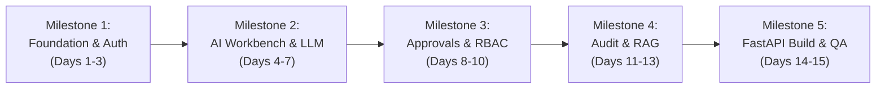

# ServerGen AI — Frontend Architecture, Developer Handover & Project Management Guide

> **Target Audience**: External Frontend Engineers, Full-Stack Developers & Engineering Leadership  
> **Backend Base**: FastAPI (Python 3.11+), SQLite / PostgreSQL 16 (Async SQLAlchemy 2.x), Ollama Local LLM  
> **Backend URL**: `http://localhost:8000` (API prefix: `/api/v1`, OpenAPI Docs: `/docs`, Telemetry: `/api/v1/health`)  
> **Active Local Model**: `llama3.2:3b` (Default in Ollama) | `gemma3:4b` (Multi-model router)  
> **Application Persona**: Enterprise AI Workbench for security-sensitive on-premise environments  
> **Design Philosophy**: High density, data-first, industrial dark theme, zero-trust deterministic controls

---

## 1. Executive Summary & Core System Principles

ServerGen AI is **not a generic consumer chatbot**. It is an **enterprise automation runtime** that subjects all actions to strict deterministic boundaries:

1. **The LLM Never Decides Security**: Risk and authorization decisions are made by deterministic Python services before and after LLM inference. The LLM never directly executes shell, SQL, or network commands.
2. **Centralized RBAC with 5 Roles**:
   * `administrator`: Complete system control, user provisioning, audit access, policy overrides.
   * `it_operator`: System diagnostics, operational tools, audit reading, task execution.
   * `security_analyst`: Audit inspection, cryptographic chain verification, security posture review.
   * `manager`: High-risk task approval, reporting, operational reviews.
   * `general_employee`: Standard queries, internal knowledge retrieval, basic tools.
3. **Deterministic Risk & Sensitivity Rating**:
   * Sensitivity: `PUBLIC`, `INTERNAL`, `CONFIDENTIAL`, `RESTRICTED`.
   * Risk: `LOW`, `MEDIUM`, `HIGH`, `CRITICAL`.
4. **Human-in-the-Loop Approvals (Separation of Duties)**:
   * Tasks requiring elevated access trigger `HTTP 202` with `policy_decision: "require_approval"`.
   * A cryptographic operation fingerprint is generated.
   * Requesters **cannot** approve their own requests (`requester != reviewer`).
5. **Tamper-Evident SHA-256 Audit Ledger**:
   * Every login, failed attempt, token refresh, policy block, tool call, and LLM inference is cryptographically hash-chained (`hash_N = SHA256(canonical_json + hash_N-1)`).

---

## 2. Recommended Frontend Tech Stack

| Component | Technology | Rationale |
|---|---|---|
| **Framework** | **React 19 + TypeScript (Strict)** | Industry standard component lifecycle, rock-solid typing against backend Pydantic models. |
| **Bundler** | **Vite** | Instant HMR, lightweight build. Compiles directly into static assets (`frontend/dist`) served natively by FastAPI. |
| **Styling** | **Tailwind CSS v4** | Rapid styling with industrial theme tokens (slate, zinc, emerald, amber, red). |
| **Component Kit** | **shadcn/ui (Radix Primitives)** | Fully accessible, headless, unstyled primitives with zero runtime bundle overhead. |
| **Icons** | **Lucide React** | Consistent technical iconography (Shield, Terminal, Cpu, Fingerprint, Lock, Eye). |
| **Server State** | **TanStack Query (React Query) v5** | Built-in polling, query invalidation, optimistic updates, and automatic caching. |
| **Client State** | **Zustand** | Minimalist store for authentication tokens, active role, theme, and draft execution payloads. |
| **HTTP Client** | **Axios** | Interceptor support for automatic Bearer headers and silent refresh-token rotation. |
| **Markdown** | **react-markdown + remark-gfm + highlight.js** | Formatted rendering of AI output, tables, and syntax-highlighted code snippets. |
| **Toasts** | **Sonner** | Clean toast notifications for policy events, approvals, and errors. |

---

## 3. Frontend Architecture & Directory Layout

```
frontend/
├── index.html
├── package.json
├── vite.config.ts
├── tsconfig.json
├── tailwind.config.js
└── src/
    ├── app/
    │   ├── App.tsx                     # Top-level routing & layout wrapper
    │   ├── routes.tsx                  # React Router route definitions
    │   └── providers.tsx               # QueryClient, Theme, Toast providers
    ├── api/
    │   ├── client.ts                   # Axios instance with Bearer & Refresh interceptors
    │   ├── auth.ts                     # Login, register, refresh, logout, getProfile
    │   ├── orchestrator.ts             # Execute task, list models, list agents
    │   ├── approvals.ts                # List, get, approve, reject, cancel
    │   ├── audit.ts                    # List events, verify hash chain
    │   ├── rag.ts                      # List documents, upload document
    │   ├── users.ts                    # Admin user management (list, create, toggle)
    │   └── types.ts                    # Exact TypeScript interfaces matching backend models
    ├── components/
    │   ├── ui/                         # shadcn/ui components (button, dialog, badge, table, tabs, etc.)
    │   ├── layout/
    │   │   ├── Header.tsx              # Top telemetry bar, model status, user menu
    │   │   ├── Sidebar.tsx             # Role-filtered navigation links
    │   │   └── AppLayout.tsx           # Main workspace shell
    │   ├── shared/
    │   │   ├── SensitivityBadge.tsx    # PUBLIC (gray), INTERNAL (blue), CONFIDENTIAL (purple), RESTRICTED (red)
    │   │   ├── RiskBadge.tsx           # LOW (green), MEDIUM (yellow), HIGH (orange), CRITICAL (red pulsating)
    │   │   ├── VerificationPill.tsx    # VERIFIED, UNVERIFIED, FAILED
    │   │   ├── FingerprintView.tsx     # Truncated hash with 1-click copy action
    │   │   └── MarkdownRenderer.tsx    # Formatted AI markdown with code blocks & citations
    ├── features/
    │   ├── auth/
    │   │   ├── AuthPage.tsx            # Unified Sign In & Account Creation (Tabs)
    │   │   ├── LoginForm.tsx           # Username, Password with Eye toggle, Remember Me
    │   │   ├── RegisterForm.tsx        # Full Name, Username, Corporate Email, Password match
    │   │   ├── DevAccountSwitcher.tsx  # 1-Click developer login buttons for the 5 seeded roles
    │   │   └── AuthGuard.tsx           # Route protection based on active role permissions
    │   ├── workbench/
    │   │   ├── WorkbenchPage.tsx       # Primary AI Execution Console
    │   │   ├── PromptInputForm.tsx     # Prompt textarea, Model picker, Sensitivity & Tool options
    │   │   ├── ModelResponseCard.tsx   # Verified output, token latency, grounded sources
    │   │   └── ApprovalPromptModal.tsx # Pop-up when task triggers human approval
    │   ├── rag/
    │   │   ├── KnowledgeBasePage.tsx   # Enterprise RAG documents catalog
    │   │   └── AddDocumentModal.tsx    # Document creation with sensitivity classification
    │   ├── approvals/
    │   │   ├── ApprovalsInboxPage.tsx  # Tabs: "My Requests" and "Review Queue"
    │   │   └── ApprovalActionModal.tsx # Reviewer notes & approve/reject buttons
    │   ├── audit/
    │   │   ├── AuditLedgerPage.tsx     # Filterable tamper-evident log table
    │   │   ├── ChainIntegrityCard.tsx  # Cryptographic SHA-256 verification banner
    │   │   └── AuditDetailDrawer.tsx   # Full JSON canonical data & hash inspector
    │   └── users/
    │       ├── UserDirectoryPage.tsx   # Admin user table (status, role, last login)
    │       └── CreateUserModal.tsx     # Admin user provisioning modal
    ├── hooks/
    │   ├── useAuth.ts                  # Login, register, logout, profile state
    │   ├── useTaskExecution.ts         # Mutation for AI task submission
    │   ├── useTelemetry.ts             # Health polling query (DB, Ollama, API)
    │   └── usePermissions.ts           # Helper to check if active role has a permission
    └── store/
        └── authStore.ts                # Access token, user, role in memory & session storage
```

---

## 4. Complete API Contracts & TypeScript Interfaces

### 4.1 Base Configuration & Headers
* **Base URL**: `http://localhost:8000` (or relative `/` when served by FastAPI static mount)
* **Required Headers**:
  * `Content-Type: application/json`
  * `Authorization: Bearer <access_token>` (for all protected endpoints)
  * `X-Request-ID: <uuid>` (automatically added by Axios client for correlation)

### 4.2 Type Definitions (`src/api/types.ts`)

```typescript
// ==================== ENUMS & CORE TYPES ====================
export type SystemRole = 
  | 'administrator'
  | 'it_operator'
  | 'security_analyst'
  | 'manager'
  | 'general_employee';

export type DataSensitivity = 'public' | 'internal' | 'confidential' | 'restricted';
export type RiskLevel = 'low' | 'medium' | 'high' | 'critical';
export type PolicyDecision = 'allow' | 'deny' | 'require_approval';
export type ApprovalStatus = 'pending' | 'approved' | 'rejected' | 'expired' | 'cancelled';
export type VerificationStatus = 'verified' | 'partially_verified' | 'unverified' | 'failed';

// ==================== AUTHENTICATION ====================
export interface RegisterRequest {
  username: string;       // 3-50 chars, alphanumeric/underscore
  email: string;          // valid corporate email
  password: string;       // min 8 chars
  full_name?: string;     // optional
}

export interface LoginRequest {
  username: string;
  password: string;
}

export interface TokenResponse {
  access_token: string;
  refresh_token: string;
  token_type: string;     // 'bearer'
  expires_in: number;     // seconds (default: 900 = 15m)
}

export interface RefreshRequest {
  refresh_token: string;
}

export interface UserProfile {
  id: string;             // UUID
  username: string;
  email: string;
  full_name: string;
  role: SystemRole;
  is_active: boolean;
  last_login: string | null;
  created_at: string;
}

// ==================== AI ORCHESTRATOR ====================
export interface TaskRequest {
  input: string;
  data_sensitivity: DataSensitivity;
  model?: string | null;  // e.g. 'llama3.2:3b', 'gemma3:4b'
  tool?: string | null;   // e.g. 'calculator', 'system_info', 'shell_execute'
  tool_parameters?: Record<string, unknown>;
  structured?: boolean;   // enforce validated JSON schema output
}

export interface GroundedSource {
  title: string;
  classification: DataSensitivity;
  relevance: number;
}

export interface TaskResponse {
  request_id: string;
  task_category: string;
  risk_level: RiskLevel;
  policy_decision: PolicyDecision;
  model_used: string;
  content: string;
  verification_status: VerificationStatus;
  tool_used: string;
  tool_output: string;
  success: boolean;
  error: string;
  approval_id: string | null;
  agent_used: string;
  operation_type: string;
  data_sensitivity: string;
  production_affecting: boolean;
  evidence: string[];
  warnings: string[];
  grounded_sources?: GroundedSource[];
}

// ==================== APPROVALS ====================
export interface ApprovalResponse {
  id: string;
  request_id: string;
  requester_user_id: string;
  requester_role: string;
  operation_summary: string;
  operation_fingerprint: string;
  status: ApprovalStatus;
  risk_assessment_json: {
    risk_level: RiskLevel;
    factors: string[];
    requires_approval: boolean;
  } | null;
  task_classification_json: {
    category: string;
    operation_type: string;
  } | null;
  reviewer_user_id: string | null;
  reviewer_notes: string | null;
  created_at: string;
  expires_at: string;
  resolved_at: string | null;
  consumed_at: string | null;
}

export interface ApprovalActionRequest {
  notes?: string;
}

// ==================== AUDIT LEDGER ====================
export interface AuditEventResponse {
  id: string;
  sequence_number: number;
  timestamp: string;
  user_id: string | null;
  role: string | null;
  request_id: string;
  event_type: string;
  action: string;
  resource: string | null;
  decision: string;
  risk_level: string;
  agent: string | null;
  model: string | null;
  tool: string | null;
  metadata_json: Record<string, unknown> | null;
  previous_hash: string | null;
  event_hash: string;
}

export interface AuditVerificationResponse {
  status: 'verified' | 'broken';
  events_checked: number;
  broken_at_sequence: number | null;
  reason?: string;
}

// ==================== RAG KNOWLEDGE BASE ====================
export interface DocumentItem {
  id: string;
  title: string;
  category: string;
  classification: DataSensitivity;
  allowed_roles: string[];
  content: string;
}

export interface CreateDocumentRequest {
  title: string;
  category: string;
  classification: DataSensitivity;
  content: string;
  allowed_roles?: string[];
}

// ==================== SYSTEM TELEMETRY ====================
export interface HealthStatusResponse {
  status: 'healthy' | 'degraded';
  service: string;
  version: string;
  database: 'connected' | 'unavailable';
  ollama: {
    status: 'connected' | 'unavailable';
    url: string;
    default_model: string;
    available_models: string[];
  };
}
```

---

## 5. Security Architecture & Token Interceptor

### Token Lifecycle & Storage Policy
1. **Access Token (`access_token`)**: Store in **Zustand memory** (fast, immune to localStorage XSS exfiltration).
2. **Refresh Token (`refresh_token`)**: Store in `sessionStorage` or secure cookies for session persistence across refreshes.
3. **Axios Silent Refresh Interceptor**:
   * When an API call returns `401 Unauthorized`:
   * Intercept failure and pause queued requests.
   * Call `POST /api/v1/auth/refresh` with `{ refresh_token }`.
   * On success: Update Zustand access token and retry the queued requests.
   * On failure / reuse: ServerGen AI invalidates the entire token family. Clear local storage and redirect to `/login` with toast: *"Session revoked or expired. Please sign in again."*

```typescript
// src/api/client.ts
import axios from 'axios';
import { useAuthStore } from '../store/authStore';

export const apiClient = axios.create({
  baseURL: import.meta.env.VITE_API_BASE_URL || '',
  headers: { 'Content-Type': 'application/json' },
});

apiClient.interceptors.request.use((config) => {
  const token = useAuthStore.getState().accessToken;
  if (token) config.headers.Authorization = `Bearer ${token}`;
  config.headers['X-Request-ID'] = crypto.randomUUID();
  return config;
});

apiClient.interceptors.response.use(
  (res) => res,
  async (error) => {
    const originalRequest = error.config;
    if (error.response?.status === 401 && !originalRequest._retry) {
      originalRequest._retry = true;
      try {
        const refreshToken = useAuthStore.getState().refreshToken;
        if (!refreshToken) throw new Error('No refresh token');
        
        const { data } = await axios.post('/api/v1/auth/refresh', { refresh_token: refreshToken });
        useAuthStore.getState().setTokens(data.access_token, data.refresh_token);
        originalRequest.headers.Authorization = `Bearer ${data.access_token}`;
        return apiClient(originalRequest);
      } catch (refreshErr) {
        useAuthStore.getState().logout();
        window.location.href = '/login';
        return Promise.reject(refreshErr);
      }
    }
    return Promise.reject(error);
  }
);
```

---

## 6. Page Specifications & User Journeys

### 6.1 Authentication Screen (`/login`)
* **Dual View**:
  * **Sign In Tab**: Username, Password with Eye toggle, Remember Session checkbox, Submit button.
  * **Create Account Tab**: Full Name, Username (alphanumeric check), Corporate Email, Password (min 8 chars), Confirm Password match check, Auto-sign-in on submission.
* **Developer Quick-Switch**: Bottom drawer or pills with 1-click login for `admin`, `operator`, `analyst`, `manager`, `employee` to accelerate testing.
* **Lockout Handling**: If HTTP 423 is returned, show timer: *"Account temporarily locked after 5 failed attempts. Try again in 30 minutes."*

### 6.2 AI Task Execution Workbench (`/workbench`)
* **Top Toolbar**:
  * **Telemetry Status Badge**: Real-time probe of `/api/v1/health` showing `Ollama: Active (llama3.2:3b)`.
  * **Model Selector Dropdown**: Populated dynamically from `/api/v1/health` (`llama3.2:3b`, `gemma3:4b`).
  * **Data Sensitivity Selector**: `PUBLIC`, `INTERNAL`, `CONFIDENTIAL`, `RESTRICTED` with risk color indicators.
  * **Tool Invocation Selector**: None (Direct LLM), Calculator, System Info, Shell Command.
* **Quick Prompt Inspiration Pills**:
  * "Explain container namespaces in Linux"
  * "Write a Python script to verify SHA-256 hash chains"
  * "Calculate 256 * 48 + 1024"
  * "Access classified executive financial records" (tests policy block)
* **Execution State**:
  * Button shows spinner: `<Spinner /> Generating with llama3.2:3b...` and elapsed latency timer (`2.4s`).
  * Button is disabled during inference to prevent double submissions.
* **Response Card**:
  * Rendered formatted Markdown (headers, code blocks with copy button, bullet points).
  * Status badges: Policy decision (`ALLOW` / `REQUIRE_APPROVAL` / `DENY`), Risk Level (`LOW` / `MEDIUM` / `HIGH` / `CRITICAL`), Verification Tag (`VERIFIED` / `UNVERIFIED`).
  * RAG Grounding sources card listing document titles and classifications when grounded.
  * Collapsible Raw JSON payload drawer for full inspection.

### 6.3 Approvals Management Center (`/approvals`)
* **Dual Tab View**:
  * `My Requests`: Tasks submitted by the user that triggered policy approval.
  * `Review Queue`: Pending requests from other users requiring decision (requires `approval.approve` permission).
* **Card Details**: Request ID, Requester name & role, Operation summary, Deterministic SHA-256 Fingerprint, Status badge (`PENDING`, `APPROVED`, `REJECTED`, `EXPIRED`).
* **Separation of Duties**: "Approve" button is strictly disabled if `requester_user_id === current_user_id`.

### 6.4 Tamper-Evident Audit Ledger (`/audit`)
* **Header Banner**: Calls `GET /api/v1/audit/verify`.
  * If verified: Green badge: `✓ Ledger Verified: N events intact. Zero anomalies.`
  * If broken: Red pulsing alert: `🚨 Tamper Detected: Hash discontinuity at sequence #X.`
* **Log Table**: Columns for `# Seq`, Timestamp, Event Type (`login_success`, `policy_denied`, `llm_request`, etc.), User/Role, Decision, Risk, and Monospaced SHA-256 Hash.
* **Detail Drawer**: Slide-out JSON inspector displaying full canonical payload and `previous_hash` link.

### 6.5 RAG Knowledge Base Viewer (`/rag`)
* **Document Catalog**: View indexed organizational records with clearance levels (`PUBLIC`, `INTERNAL`, `CONFIDENTIAL`, `RESTRICTED`).
* **Add Document Modal**: Form for authorized users to register new organizational knowledge.

---

## 7. Role-Based Permission Matrix

| Feature / Screen | Administrator | IT Operator | Security Analyst | Manager | General Employee |
|---|:---:|:---:|:---:|:---:|:---:|
| **AI Workbench (`/workbench`)** | Full Access | Full Access | Read-Only / Advisory | Full Access | Full Access |
| **Data Sensitivity Picker** | Up to `RESTRICTED` | Up to `CONFIDENTIAL` | Up to `RESTRICTED` | Up to `CONFIDENTIAL` | Capped at `INTERNAL` |
| **Review Approvals (`/approvals`)** | Full | ❌ | ❌ | High/Medium | ❌ |
| **View Audit Ledger (`/audit`)** | Full | Full | Full | ❌ | ❌ |
| **Verify Hash Chain** | Yes | Yes | Yes | ❌ | ❌ |
| **User Directory (`/users`)** | Read & Write | Read Only | ❌ | Read Only | ❌ |

---

## 8. Project Management & Delivery Blueprint

To successfully manage your external developer or frontend team, organize execution into **5 milestone phases**:



### Milestone Breakdown & Acceptance Criteria

#### Milestone 1: Project Scaffolding & Authentication (Days 1–3)
* **Tasks**:
  * Scaffold Vite + React + TypeScript + Tailwind CSS.
  * Implement `src/api/client.ts` with token storage and Axios refresh interceptor.
  * Build `AuthPage.tsx` with Sign In, Create Account (Registration), and Dev Account Switcher.
  * Implement top header with user profile badge and logout action.
* **Acceptance Criteria**:
  * Registering a new account (`POST /api/v1/auth/register`) creates a user and signs in immediately.
  * Logging in with seeded credentials (`admin` / `admin`) succeeds and displays role badge.
  * Refresh token rotation functions automatically on expired access tokens.

#### Milestone 2: AI Execution Workbench & Real Model Output (Days 4–7)
* **Tasks**:
  * Implement `/workbench` with prompt textarea, model dropdown, sensitivity selector, and tool options.
  * Add quick prompt inspiration pills.
  * Add live progress spinner and elapsed latency counter during inference.
  * Render model responses using `react-markdown` with syntax-highlighted code blocks.
  * Handle policy decision tags (`ALLOW`, `REQUIRE_APPROVAL`, `DENY`).
* **Acceptance Criteria**:
  * Prompting *"Explain Linux cgroups"* triggers `llama3.2:3b` via Ollama and renders clean Markdown.
  * Selecting "Calculator" runs AST math calculations cleanly.
  * Selecting `RESTRICTED` triggers the Approval Required banner and displays the `approval_id`.

#### Milestone 3: Approvals Workflow & RBAC Route Protection (Days 8–10)
* **Tasks**:
  * Implement `/approvals` with "My Requests" and "Review Queue" tabs.
  * Implement approve/reject modal with reviewer notes.
  * Enforce separation of duties (prevent self-approval).
  * Build `AuthGuard` to restrict tabs/buttons based on role permissions.
* **Acceptance Criteria**:
  * An employee triggers an approval -> manager logs in -> manager approves it with notes -> employee sees status updated to `APPROVED`.
  * Employee cannot view the review queue or approve requests.

#### Milestone 4: Tamper-Evident Audit Ledger & RAG Knowledge Base (Days 11–13)
* **Tasks**:
  * Implement `/audit` with filterable event table and slide-out detail drawer.
  * Implement one-click cryptographic hash chain verification banner (`GET /api/v1/audit/verify`).
  * Implement `/rag` for viewing and indexing organizational documents.
* **Acceptance Criteria**:
  * Audit ledger displays real-time event sequences.
  * Clicking "Verify Hash Chain" displays a green verification banner with checked count.
  * Security analyst role has full access; employee role is forbidden (403).

#### Milestone 5: Production Build, FastAPI Integration & Handover QA (Days 14–15)
* **Tasks**:
  * Configure `vite.config.ts` to output to `frontend/dist`.
  * Verify FastAPI serves the production build natively via `GET /test` or root `/`.
  * Run end-to-end user testing across all 5 roles.
* **Acceptance Criteria**:
  * Running `npm run build` generates production assets in `frontend/dist`.
  * Entire application is functional without Node.js running in production.

---

## 9. Developer Setup & Fast-Track Commands

Share these exact commands with your developer:

```bash
# 1. Clone repository & enter frontend directory
git clone <repo-url>
cd servergen-ai

# 2. Start Backend & Ollama (in one terminal)
.venv\Scripts\activate
python -m uvicorn src.app:app --reload --port 8000

# 3. Scaffold / Enter Frontend
cd frontend
npm install

# 4. Configure .env.development
echo "VITE_API_BASE_URL=http://localhost:8000" > .env.development

# 5. Start Frontend Dev Server
npm run dev
# Frontend runs at: http://localhost:3000 (proxies /api to http://localhost:8000)
```

---

## 10. How to Monitor & Test Your Developer's Progress

Use this simple verification checklist whenever your developer delivers a milestone:

1. **Test Registration**: Open `/login`, click *Create Account*, enter `testdev` / `testdev@servergen.local` / `DevPass123!`. Verify you are registered, logged in, and assigned the `general_employee` role.
2. **Test Model Inference**: Open `/workbench`, click the prompt *"Docker Architecture"*, click *Execute*. Verify that `llama3.2:3b` generates a comprehensive Markdown response with latency statistics.
3. **Test Policy Intercept**: Select `RESTRICTED` sensitivity and click *Execute*. Verify an alert pops up displaying an `approval_id`.
4. **Test Separation of Duties**: Switch user to `manager`, navigate to `/approvals`, locate the request, enter notes, and click *Approve*.
5. **Test Ledger Integrity**: Switch user to `analyst`, open `/audit`, and click *Verify Hash Chain*. Verify the cryptographic hash chain is verified with 0 anomalies.
