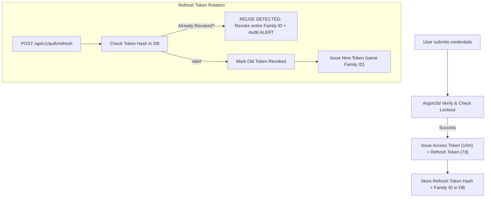
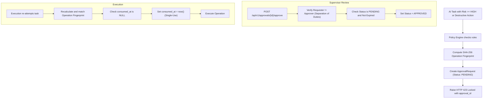
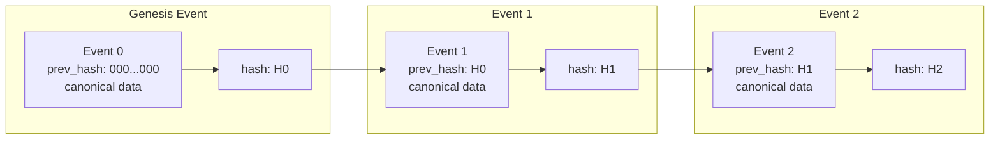

# ServerGen AI — Security Architecture & Threat Model

> **Classification**: CONFIDENTIAL / SECURITY BENCHMARK  
> **Status**: APPROVED  
> **Audience**: Lead Architects, Security Officers, Audit Committees, and Compliance Teams.

---

## 1. Security Philosophy & Threat Model

ServerGen AI is engineered for high-assurance, sovereign environments such as Public Sector Undertakings (PSUs), refineries, industrial automation control centers, government departments, and defence-linked contractors.

### Core Security Tenets
1. **Zero-Trust Towards AI Models**:
   - Machine learning models are probabilistic generative systems susceptible to hallucinations, jailbreaks, prompt injections, and data fabrication.
   - In ServerGen AI, the LLM is treated as an **untrusted advisory channel**.
   - Model outputs NEVER dictate authorization, data classifications, risk levels, or system execution.
2. **Deterministic Control Plane**:
   - All access decisions, data boundaries, and operational risks are evaluated by deterministic Python logic prior to dispatching prompts to the LLM.
3. **Immutability and Non-Repudiation**:
   - All security-relevant actions produce cryptographic hash-chained audit events that cannot be rewritten or reordered without detection.

### Mitigated Threat Vectors

| Threat Vector | Potential Impact | ServerGen AI Mitigation |
| :--- | :--- | :--- |
| **Prompt Injection & Jailbreaks** | Model attempts to execute unauthorized commands or bypass policy. | The model has **zero execution capability**. Tools are strictly pre-validated, read-only, and invoked only if authorized by deterministic policy. |
| **LLM "Confidence" Deception** | Model reports high confidence (e.g. 0.99) on malicious/fabricated assertions. | **Confidence scores are discarded**. Output reliability is established exclusively via deterministic verifiers, evidence lists, and human review. |
| **Privilege Escalation via JWT** | Attacker tampers with claims or replays expired tokens. | Fixed HS256 algorithm enforcement; live database re-validation of user active status and current role on every single request. |
| **Token Theft & Replay** | Stolen refresh token used to maintain persistence. | Refresh Token Family Rotation: presenting a previously consumed token triggers immediate revocation of the entire token family. |
| **Parameter Tampering in Approvals** | Attacker changes command parameters after obtaining supervisor approval. | Deterministic **SHA-256 Operation Fingerprint** ties approval to exact parameters, tool, and caller context. |
| **Audit Ledger Manipulation** | Rogue administrator modifies database records to hide unauthorized actions. | **Continuous SHA-256 Hash Chain** with PostgreSQL transaction-level advisory locks ensures broken continuity is detected instantly. |
| **Timing Attacks on Authentication** | Attacker deduces valid usernames or passwords via response latency. | Argon2id constant-time verification via `argon2-cffi`. |
| **Credential Harvesting via Logs** | Sensitive credentials logged in audit records or traces. | Automated recursive redaction of keys (`password`, `token`, `secret`, `authorization`, `api_key`). |

---

## 2. Authentication & Identity Management

### 2.1 Password Hashing with Argon2id

Passwords are never stored in plaintext. ServerGen AI uses **Argon2id** (the hybrid version of Argon2 combining Argon2d and Argon2i), configured according to RFC 9106 and OWASP enterprise recommendations:

```python
Type:        Argon2id
Memory:      64 MiB (65,536 KiB)
Time Cost:   3 iterations
Parallelism: 4 threads
Salt:        16 bytes CSPRNG
Hash Length: 32 bytes
```

- **Implementation**: `argon2-cffi` backed by the reference C implementation.
- **Timing Invariance**: Password verification runs in constant time regardless of match correctness, neutralizing side-channel timing analysis.

### 2.2 Account Lockout Protection

To defend against online brute-force and credential stuffing:
- Tracks consecutive failed attempts in `users.failed_login_attempts`.
- Exceeding `MAX_LOGIN_ATTEMPTS` (default: 5) sets `users.locked_until = now() + 30 minutes`.
- Further login attempts during lockout return `HTTP 423 Locked`.
- Successful authentication resets `failed_login_attempts = 0` and clears `locked_until`.
- All failed and locked attempts generate `LOGIN_FAILURE` audit events.

---

## 3. Session Security & JWT Hardening

ServerGen AI implements an OAuth2-style Bearer token architecture with hardened JWT validation.



### 3.1 Access Token Specifications
- **Format**: Signed JWT.
- **Algorithm**: **Strictly Fixed to `HS256`**. The `alg` header of incoming tokens is ignored and rejected if it specifies any algorithm other than HS256 (neutralizing algorithm switching attacks such as `none` or RSA/HMAC confusion).
- **Lifetime**: 15 minutes (`ACCESS_TOKEN_EXPIRE_MINUTES = 15`).
- **Validated Claims**:
  - `sub`: User UUID.
  - `role`: Role at token issuance (used for reference only; authorization re-reads live role).
  - `typ`: MUST equal `"access"`.
  - `iss`: Configured issuer (`servergen-ai`).
  - `aud`: Configured audience (`servergen-ai-api`).
  - `jti`: Unique token UUID.
  - `iat` / `exp`: Issue and expiration UTC timestamps.

### 3.2 Refresh Token Family Rotation

Refresh tokens allow users to obtain new access tokens without re-entering credentials:
- **Lifetime**: 7 days (`REFRESH_TOKEN_EXPIRE_MINUTES = 10080`).
- **Database Storage**: Only the SHA-256 hash of the token string is stored in `refresh_sessions.token_hash`. Plaintext refresh tokens are never persisted.
- **Single-Use Rotation**: When a refresh token is exchanged, it is immediately flagged as `is_revoked = True`, and a new refresh token is issued under the same `family_id`.
- **Reuse Detection**: If a revoked refresh token is presented, the system flags a token theft breach, immediately revokes **all** active tokens belonging to that `family_id`, and writes a high-priority audit record (`TOKEN_REVOKED_REUSE`).
- **Session Termination**:
  - Logout revokes the specific token session.
  - Changing a password or disabling a user immediately revokes **all** active sessions across all devices.

### 3.3 Live DB Identity Verification

ServerGen AI does **not** rely on claims inside the JWT to authorize actions:
1. The bearer JWT is validated cryptographically.
2. The user row is queried live from the database with eager-loaded role and permissions:
   ```python
   user = await UserRepository(db).get_by_id(user_uuid)
   if user is None or not user.is_active or user.role is None:
       raise AuthenticationError("Account is not available")
   ```
3. Disabling a user or changing their role takes effect **immediately**, even if their access token has not yet expired.

---

## 4. Role-Based Access Control (RBAC)

### 4.1 System Roles & Hierarchy

Permissions follow the standard `resource.action` nomenclature:

| System Role | Intended Audience | Key Permissions |
| :--- | :--- | :--- |
| `administrator` | System administrators & compliance leads | Complete access: `user.read/write`, `role.read/write`, `system.manage`, `approval.review`, `audit.read`, `ai.execute`. |
| `it_operator` | DevOps, infrastructure & SRE staff | `system.read`, `operations.execute`, `tool.execute`, `ai.execute`, `document.read`. |
| `security_analyst`| InfoSec & cybersecurity engineers | `security.read/execute`, `audit.read`, `approval.review`, `document.read`, `ai.execute`. |
| `manager` | Department supervisors & team leads | `approval.review`, `document.read`, `ai.execute`. |
| `general_employee`| General knowledge workers | Restricted baseline: `document.read`, `ai.execute`. |

### 4.2 Dynamic Database Fallback

- Role-permission assignments are stored in the `role_permissions` join table in PostgreSQL.
- The RBAC guard loads assigned permissions directly from the database; if not seeded, it transparently falls back to canonical immutable Python definitions (`DEFAULT_ROLE_PERMISSIONS`).

---

## 5. Cryptographic Approval System (HITL)

Risky operations (e.g., destructive actions, critical infrastructure queries, modifying security baselines) cannot be executed unilaterally.



### 5.1 Operation Fingerprinting
To prevent Time-of-Check to Time-of-Use (TOCTOU) and parameter substitution attacks:
$$\text{Payload} = \text{user\_id} \parallel \text{role} \parallel \text{tool} \parallel \text{canonical\_json}(\text{parameters}) \parallel \text{sensitivity} \parallel \text{risk\_level}$$
$$\text{Fingerprint} = \text{SHA-256}(\text{Payload})$$

If the parameters or context change in any way when the task is re-submitted, the fingerprint mismatch rejects the request.

### 5.2 Separation of Duties (Four-Eyes Principle)
```python
if approval.requester_id == reviewer_id:
    raise AuthorizationError("Requester cannot approve their own request")
```
An administrator or manager cannot approve an operation they initiated.

### 5.3 Single-Use Consumption
Once an approved operation executes, `consumed_at` is marked with the current timestamp. Any subsequent attempt to use the same approval ID is rejected.

---

## 6. Tamper-Evident AI Activity Ledger

Every security-relevant event is recorded in `audit_events`.

### 6.1 Cryptographic Hash Chain

The ledger forms an immutable, forward-linked SHA-256 chain:

$$H_0 = \text{SHA256}(\text{"0"*64} \parallel \text{canonical\_json}(E_0))$$
$$H_N = \text{SHA256}(H_{N-1} \parallel \text{canonical\_json}(E_N))$$



### 6.2 Canonical Serialization
To ensure hash stability across architectures, languages, and database re-indexing:
- JSON keys are sorted alphabetically (`sort_keys=True`).
- Delimiters are compact: `(',', ':')` without whitespace.
- Timestamps are formatted as ISO 8601 UTC with second precision (`YYYY-MM-DDTHH:MM:SSZ`).
- Floats are rounded to deterministic string representations.

### 6.3 Concurrency Control via Advisory Locks
To eliminate race conditions and fork creation during concurrent requests, the audit writer acquires a PostgreSQL transaction-level advisory lock:
```sql
SELECT pg_advisory_xact_lock(0x53474149); -- 'SGAI'
```
This guarantees that only one transaction computes `H_N = SHA256(H_{N-1} + E_N)` at any instant, ensuring perfect sequential chain continuity.

### 6.4 Automated Integrity Verification
The `/api/v1/audit/verify` endpoint verifies the entire ledger from genesis:
1. Re-computes canonical hashes for every record.
2. Checks that `event.previous_hash == prior_event.event_hash`.
3. Detects:
   - Modified event fields.
   - Deleted events.
   - Inserted / reordered events.
   - Truncated chains.

### 6.5 Sensitive Data Redaction
Before any metadata dictionary is written to the audit database or returned via the API, it passes through a recursive scrubber:
- Any key matching `password`, `token`, `secret`, `authorization`, `cookie`, `key`, `credential`, or `bearer` is replaced with `"[REDACTED]"`.

---

## 7. Zero-Trust LLM Boundary & Tool Sandboxing

### 7.1 Input & Prompt Sanitization
- User inputs are normalized (UTF-8) and length-capped (`max_tokens: 1024` default).
- Prompts are prefixed with immutable enterprise system instructions that cannot be overridden by user inputs.

### 7.2 Tool Confinement: Safe AST Math Tool
When evaluating mathematical operations, ServerGen AI **strictly rejects `eval()` and `exec()`**. The `SafeCalculatorTool` evaluates expressions using the Python Abstract Syntax Tree (`ast`):
- Whitelisted AST nodes: `Expression`, `BinOp`, `UnaryOp`, `Constant`, `Num`.
- Whitelisted operators: `Add`, `Sub`, `Mult`, `Div`, `FloorDiv`, `Mod`, `Pow`, `USub`, `UAdd`.
- Any call (`ast.Call`), attribute access (`ast.Attribute`), name resolution (`ast.Name`), or comprehension triggers an immediate evaluation failure.

---

## 8. Rate Limiting Specifications

ServerGen AI enforces sliding-window rate limiting to prevent denial of service and LLM resource exhaustion:

| Category | Default Limit | Window | Action on Violation |
| :--- | :--- | :--- | :--- |
| `LOGIN` | 10 requests | 300 seconds (5 min) | HTTP 429 + Security Alert |
| `API` | 300 requests | 60 seconds (1 min) | HTTP 429 |
| `LLM` | 20 requests | 60 seconds (1 min) | HTTP 429 |
| `TOOL` | 50 requests | 60 seconds (1 min) | HTTP 429 |

Rate limiting is evaluated prior to database queries and LLM execution.
