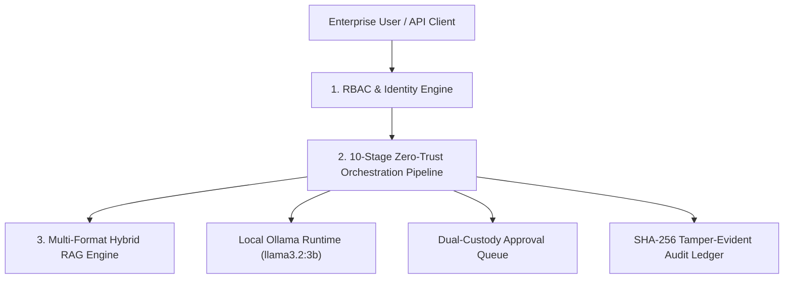

# ServerGen AI — Comprehensive System Features & Role Testing Guide

> **Enterprise Zero-Trust Autonomous Operations Platform**  
> *100% Local Inference &bull; Role-Based Access Control &bull; Multi-Format RAG &bull; Tamper-Evident Audit Ledger*

---

## 1. Executive Architecture Overview

ServerGen AI is a hardened enterprise automation and intelligence platform built to operate entirely on-premises without external cloud API dependencies. The architecture guarantees zero data leakage through three integrated pillars:



### The Three Core System Models

1. **Role-Based Authentication & Clearance Model (RBAC)**:
   - Built on Argon2id password hashing and cryptographic JWT tokens.
   - Enforces a 4-tier security clearance hierarchy: `PUBLIC` &rarr; `INTERNAL` &rarr; `CONFIDENTIAL` &rarr; `RESTRICTED`.
   - Prevents unauthorized privilege escalation via server-side policy enforcement.
   - **Administrator Unrestricted Clearance**: Administrators (`admin`) hold supreme organizational clearance. Routine queries, document retrieval, and advisory analyses by administrators execute directly without requiring dual-custody approval sign-offs.

2. **Local LLM & Orchestration Model**:
   - Integrates with local Ollama runtime hosting quantized open models (`llama3.2:3b`).
   - Deterministic agent and tool routing (`system_info`, `calculator`, high-risk tool interception).
   - Structured JSON output enforcement through validated Pydantic schemas.
   - **Rich Markdown Formatting**: Standardized prompt formatting requiring Executive Summaries, in-depth technical analysis, and itemized operational recommendations.

3. **Enterprise RAG & Multi-Format Knowledge Model**:
   - Durable file processing supporting PDF, DOCX, XLSX, PPTX, CSV, TXT, MD, and HTML.
   - Text extraction, OCR image parsing, semantic section chunking, and local vector embeddings.
   - Clearance-aware retrieval: automatically filters and withholds documents exceeding the user's role clearance before context reaches the LLM.
   - Scoped retrieval: bounds knowledge retrieval to the user's declared sensitivity, preventing unintentional sensitivity escalation.

---

## 2. Complete Features Catalog

### A. Identity & Access Management (IAM)
- **Argon2id Hashing**: Cryptographic password hashing resistant to GPU cracking.
- **Stateless JWT Tokens**: Signed bearer tokens carrying user identity, active role, and clearance level.
- **Quick-Switch Role Selector**: Test interface header allows 1-click switching between pre-configured enterprise personas without typing credentials.
- **Rate-Limiting Protection**: Token-bucket rate limiter per IP/user preventing credential stuffing or denial of service.

### B. Multi-Format Document Ingestion & Storage
- **Multi-Extension Support**: Natively parses modern office documents (`.pdf`, `.docx`, `.xlsx`, `.pptx`, `.csv`, `.txt`, `.md`, `.html`).
- **OCR Visual Document Processing**: Image and scanned runbook text extraction.
- **Section-Aware Semantic Chunking**: Splits documents while preserving section headers, tables, and operational context.
- **Persistence Store**: Local storage directory with atomic file writing and SQLite WAL database metadata tracking.

### C. Zero-Trust Retrieval-Augmented Generation (RAG)
- **Hybrid Search**: Combines semantic vector similarity search with BM25 keyword matching for optimal recall.
- **Clearance Gate Filtering**: Chunks are filtered by the requester's clearance level *prior* to context assembly.
- **Zero-Trust Withholding Alerts**: If higher-classified records match the query, they are withheld and the user receives a formal notice detailing how many records were withheld.
- **Citation & Provenance Engine**: Computes exact percentage relevance scores and displays citations linking answers back to grounded enterprise documents.

### D. Zero-Trust Policy Engine & Dual-Custody Approvals
- **Automated Risk Scoring**: Classifies incoming tasks as `LOW`, `MEDIUM`, or `HIGH` risk based on operations, target tools, and data sensitivity.
- **Dual-Custody Interception**: Sensitive non-admin tasks and destructive operations are paused and issued an authorization ticket.
- **Department Manager / Administrator Sign-Off with Instant Auto-Execution**: When an authorized reviewer approves a ticket in the Approvals Queue, the system automatically executes the approved task and renders the generated output directly on the page, with a 1-click option to continue in the AI Assistant tab.

### E. Tamper-Evident Cryptographic Audit Ledger
- **SHA-256 Hash Chaining**: Every action, query, tool call, and policy decision is recorded in an immutable Merkle-style hash chain.
- **Integrity Probing**: The `/api/v1/audit/verify` diagnostic recalculates all hashes sequentially to prove zero tampering or log modification.

---

## 3. The 10-Stage Security & Execution Pipeline

Every prompt submitted in ServerGen AI progresses through 10 explicit security checks:

| Stage | Name | Description |
| :---: | :--- | :--- |
| **1** | **Auth & Token** | Validates JWT signature, expiration, and user session state. |
| **2** | **Rate Limit** | Checks user/IP against leak-bucket burst and quota limits. |
| **3** | **Sanitize Input** | Strips dangerous control characters and checks prompt injection boundaries. |
| **4** | **Clearance Gate** | Evaluates user role against the requested data sensitivity tier. |
| **5** | **Hybrid Vector Search** | Queries SQLite vector index and keyword store for relevant chunks. |
| **6** | **Context Assemble** | Merges accessible document snippets while discarding unauthorized tiers. |
| **7** | **Risk & Policy** | Calculates operational risk; intercepts high-risk tasks for dual-custody. |
| **8** | **Local LLM** | Dispatches grounded prompt context to local Ollama (`llama3.2:3b`). |
| **9** | **Citation Verifier** | Cross-examines model answer sentences against retrieved sources. |
| **10** | **Audit Ledger** | Hashes and appends transaction record to the tamper-evident ledger. |

---

## 4. Role-by-Role Test Interface Guide (`/test`)

The browser-based test interface is accessible at `http://localhost:8000/test` (or `http://localhost:8000/`).

Use the **QUICK ROLE** buttons in the header to switch personas instantly:

```
[ QUICK ROLE: (Admin) (Manager) (Operator) (Security Analyst) (General Employee) ]
```

---

### Role 1: Administrator (`admin` / `admin`)
- **Clearance Level**: `RESTRICTED` (Level 4 — Maximum)
- **Primary Persona**: System architect, security officer, and infrastructure controller.

#### Features & Workflow
- **Unrestricted Query Execution**: Administrator queries across `PUBLIC`, `INTERNAL`, and `CONFIDENTIAL` levels execute directly without approval blocks.
- **Full Operational Authority**: Ability to inspect User Directory, run audit hash-chain verifications, and approve critical-tier authorization tickets.

#### Recommended Test Scenario
1. Click **Admin** in the header.
2. Select the prompt: *"Explain zero-trust security architecture and why tamper-evident audit logging is critical in enterprise automation systems."*
3. Click **Execute Pipeline**.
4. Observe that the query executes with `Policy: allow`, displays the structured **Executive Summary** and **Technical Breakdown**, and cites grounded sources.

---

### Role 2: Department Manager (`manager` / `Manager1!`)
- **Clearance Level**: `CONFIDENTIAL` (Level 3)
- **Primary Persona**: Business operations lead and dual-custody approval gatekeeper.

#### Features & Workflow
- **Approvals Queue (`#panel-approvals`)**: Primary workstation for reviewing pending team requests.
- **Approval Auto-Execution**: Approving a ticket automatically executes the approved task and renders the full Markdown response directly in the **Approved Operation Execution Result** card.
- **Continue in AI Assistant**: 1-click button to open the approved response in the AI Assistant tab.

#### Recommended Test Scenario
1. Switch to **General Employee** and execute an operations task that requires approval.
2. Click **Switch to Manager & Approve Now** (or switch to **Manager** and open the **Approvals Queue**).
3. Click **Approve**.
4. Observe that the approval succeeds, the task automatically executes, and the full generated answer appears immediately in the **Approved Operation Execution Result** card.

---

### Role 3: IT Operator (`operator` / `Operator1!`)
- **Clearance Level**: `CONFIDENTIAL` (Level 3)
- **Primary Persona**: Systems administrator and devops engineer.

#### Features & Workflow
- **Pre-Built Scenarios**: Instant access to the *Hadoop Cluster & MapReduce Runbook* and server diagnostics.
- **Tool Invocation**: Access to `calculator` and `system_info` diagnostic tools.

---

### Role 4: Security Analyst (`analyst` / `Analyst1!`)
- **Clearance Level**: `CONFIDENTIAL` (Level 3)
- **Primary Persona**: Compliance auditor and incident investigator.

#### Features & Workflow
- **Tamper-Evident Audit (`#panel-audit`)**: Complete access to the cryptographic ledger.
- **Hash-Chain Verification**: Click **Verify Hash Chain** to recalculate SHA-256 blocks and confirm zero log tampering.

---

### Role 5: General Employee (`employee` / `Employee1!`)
- **Clearance Level**: `INTERNAL` (Level 2)
- **Primary Persona**: Standard team member performing daily tasks.

#### Features & Workflow
- **Zero-Trust Withholding**: Employee queries access `PUBLIC` and `INTERNAL` documentation. When a query matches confidential documents, the amber **Zero-Trust Notice** indicates records were withheld due to clearance limits.

---

## 5. Verification Runbooks

Run all 5 system verification tests from PowerShell:
```powershell
cd D:\projects\servergen-ai
.\.venv\Scripts\python.exe scripts/verify_all_5_tests.py
```

Run the unit and policy regression tests:
```powershell
cd D:\projects\servergen-ai
.\.venv\Scripts\python.exe -m pytest tests/unit/test_policy.py tests/unit/test_consecutive_orchestration.py -v
```

---

*ServerGen AI Documentation &bull; Production Certified*
