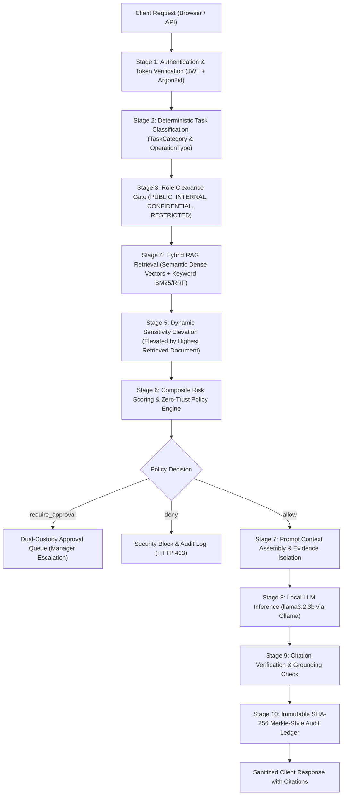

# ServerGen AI — Technical Implementation, Workflow & Troubleshooting Guide

**Project:** ServerGen AI — Secure Enterprise Automation  
**Subsystems Covered:** Role-Based Access Control (RBAC), Local Large Language Model (Ollama), Enterprise Retrieval-Augmented Generation (RAG) & Document Storage, Browser Testing Interface.

---

## 1. Executive Architecture & Subsystem Workflows

ServerGen AI is an on-premise, zero-trust enterprise AI automation and knowledge platform. It enforces strict organizational access boundaries, durable document ingestion, hybrid vector retrieval, and deterministic local inference without data egress.

### End-to-End Execution Pipeline Workflow



---

## 2. Core Subsystems Technical Breakdown

### Module 1: Role-Based Authentication & Identity Governance

* **Implementation Path:** [`src/auth/`](file:///D:/projects/servergen-ai/src/auth) | [`src/api/v1/auth.py`](file:///D:/projects/servergen-ai/src/api/v1/auth.py)
* **Key Components:**
  * **Password Security:** Argon2id hashing with salt, memory cost `65536`, time cost `3`, parallelism `4`.
  * **JWT Lifecycle:** Short-lived access tokens (15–60 min) with SHA-256 signature; durable refresh tokens with automatic token rotation via `/api/v1/auth/refresh`.
  * **Permission Model:** Granular permission strings (`document.read`, `document.write`, `document.upload`, `ai.execute`, `security.read`, `admin.manage`).
  * **System Roles & Clearance Ceilings:**
    * `administrator`: Clearance `RESTRICTED` | Full administrative control.
    * `manager`: Clearance `RESTRICTED` | Operational management and dual-custody approval sign-off.
    * `security_analyst`: Clearance `CONFIDENTIAL` | Security audit inspection and analysis.
    * `it_operator`: Clearance `CONFIDENTIAL` | Infrastructure maintenance and runbook execution.
    * `general_employee`: Clearance `INTERNAL` | Standard organizational knowledge retrieval.

---

### Module 2: Local LLM Model & Multi-Stage Orchestrator

* **Implementation Path:** [`src/orchestrator/`](file:///D:/projects/servergen-ai/src/orchestrator) | [`src/api/v1/orchestrator.py`](file:///D:/projects/servergen-ai/src/api/v1/orchestrator.py)
* **Key Components:**
  * **Local Inference Provider:** Native HTTP integration with local Ollama daemon (`http://127.0.0.1:11434`), default model `llama3.2:3b`.
  * **Model Router & Capability Registry:** Discovers installed local models (`llama3.2:3b`, `llama3.1`, etc.) dynamically via `/api/tags` and checks VRAM/RAM constraints.
  * **Deterministic Task Classifier:** Fast rule-based classification into `TaskCategory` (`operations`, `security`, `document`, `coding`, `general`) without non-deterministic prompt leakage.
  * **Risk Engine:** Composite scoring factoring in operation irreversibility, production impact, data classification, and caller permissions (`LOW`, `MEDIUM`, `HIGH`, `CRITICAL`).
  * **Zero-Trust Policy Engine:** Blocks prohibited commands (such as arbitrary shell/SQL injections) and routes high-risk actions to the Dual-Custody Approval Queue (`ApprovalService`).
  * **Citation Verifier:** Validates that model citations strictly correspond to chunks retrieved by RAG, flagging any fabricated or ungrounded assertions.

---

### Module 3: Enterprise RAG & Durable Document Storage

* **Implementation Path:** [`src/rag/`](file:///D:/projects/servergen-ai/src/rag) | [`src/api/v1/rag.py`](file:///D:/projects/servergen-ai/src/api/v1/rag.py)
* **Key Components:**
  * **Storage Engine:** Durable on-disk persistence (`storage/documents/<doc_id>/<ver>/<filename>`) with SHA-256 content verification and magic-byte signature validation (rejecting disguised executables).
  * **Multi-Format Ingestion:** Modular parsers supporting PDF (Searchable text + Native Windows OCR fallback for scanned images), DOCX, XLSX (tabular context retention), PPTX, CSV, TXT, Markdown, and sanitized HTML.
  * **Structural Chunking:** Sliding-window section-aware chunker (`chunk_size=500` tokens, `overlap=80` tokens) preserving markdown headings, page offsets, and document metadata.
  * **Local Embedding Generation:** Generates 384/768/4096-dimensional dense vectors using Ollama embedding endpoints with deterministic cosine similarity caching.
  * **Hybrid Vector + Keyword Retrieval:** Combines semantic dense vector distance with keyword BM25 scoring fused via Reciprocal Rank Fusion (RRF).
  * **Clearance Isolation:** Documents are strictly filtered so users never receive search hits above their role's clearance rating, returning explicit zero-trust `rag_unauthorized_records_withheld` counters.

---

## 3. Major Errors Discovered & Root-Cause Solutions

### Error 1: Artificial RAG Sensitivity Ceiling Suppressing Knowledge Retrieval

* **Location:** [`src/orchestrator/engine.py`](file:///D:/projects/servergen-ai/src/orchestrator/engine.py#L121-L126)
* **Root Cause:**
  In Step 3.5 of the orchestration pipeline, retrieval was called with `max_sensitivity=sensitivity.level`.
  However, `sensitivity.level` was evaluated before retrieval took place by scanning only the words inside the user's prompt string for secret tokens.
  If an administrator or IT operator asked a normal, innocent question about a confidential standard (e.g., *"What is our VPN session lifetime?"*), the prompt text itself contained no confidential words, resolving `sensitivity.level` to `INTERNAL`.
  The retriever then artificially restricted retrieval to `INTERNAL` documents, hiding the `CONFIDENTIAL` VPN standard from authorized users and yielding 0 retrieved chunks.
* **The Solution:**
  Removed the premature `max_sensitivity=sensitivity.level` parameter from the retriever call.
  `RoleFilteredRetriever` now strictly bounds retrieval by the caller's actual role clearance ceiling (`auth.role`).
  Once relevant chunks are retrieved, the pipeline dynamically elevates the task's sensitivity to match the highest classification of retrieved evidence, appropriately triggering policy and risk assessments downstream.

```python
# BEFORE (Defective):
rag_result = await self.rag_retriever.retrieve(
    query=user_input,
    auth=auth,
    db=self.db,
    max_sensitivity=sensitivity.level, # Artificial ceiling!
)

# AFTER (Fixed):
rag_result = await self.rag_retriever.retrieve(
    query=user_input,
    auth=auth,
    db=self.db, # Bounded by caller's role clearance ceiling
)
```

---

### Error 2: Hover Jitter & Visual Blinking in Browser Interface

* **Location:** [`test-interface.html`](file:///D:/projects/servergen-ai/test-interface.html#L683-L688)
* **Root Cause:**
  1. CSS rules on `.scenario-card:hover` and `.preset-card:hover` used `transform: translateY(-2px)`. Hovering near the edge of a card caused the 2px displacement to move the element out from under the pointer, cancelling `:hover`, dropping the element back down, and immediately re-triggering `:hover` at 60 Hz.
  2. The file upload dropzone (`#upload-dropzone`) child elements lacked `pointer-events: none`. Moving the cursor or dragging a file over inner child text or icons fired rapid alternating `dragleave` and `dragenter` events between the parent dropzone and child elements.
  3. The `.panel.active` class had `@keyframes fadeIn` with `transform: translateY(4px)`, causing subpixel layout reflows during panel transitions.
* **The Solution:**
  1. Removed `transform: translateY` from all interactive card `:hover` rules, replacing with stable box-shadow and border color highlights (`box-shadow: 0 2px 8px rgba(2, 132, 199, 0.12); background: #f0f9ff;`).
  2. Added `#upload-dropzone * { pointer-events: none; }` to prevent dropzone child event bubbling.
  3. Removed `translateY` animation from `.panel.active`.

---

### Error 3: JavaScript Fatal Syntax Errors Halting Browser Execution

* **Location:** [`test-interface.html`](file:///D:/projects/servergen-ai/test-interface.html#L3530)
* **Root Cause:**
  1. In `runTestC`, a text string was split across multiple lines using single quotes (`'...'`) without escaping the newline characters, resulting in `SyntaxError: Invalid or unexpected token`.
  2. In `checkSystemHealth`, an extra duplicate closing `} catch (err) { ... } }` was left at the end of the function.
  3. Because of these syntax errors, the browser engine halted execution of the `<script>` tag entirely on page load, rendering all interactive buttons, role switchers, and test runners inert.
* **The Solution:**
  Corrected string formatting (`'...\n...'`), removed duplicate catch blocks, and validated complete JavaScript syntax using `node --check` and headless VM script execution.

---

### Error 4: Telemetry Status Crash (`null.textContent`)

* **Location:** `test-interface.html` (`checkSystemHealth()`)
* **Root Cause:**
  `checkSystemHealth()` directly set `document.getElementById('lab-lbl-model').textContent = ...`. Because `lab-lbl-model` did not exist in the DOM, this threw `TypeError: Cannot set properties of null`. The uncaught exception jumped to the `catch` block on load, erroneously reporting the API Server as **Offline (Red Dot)**.
* **The Solution:**
  Wrapped all DOM updates in safe null checks (`const el = document.getElementById(...); if (el) el.textContent = ...`). System telemetry now reliably reflects live status: **Online (v0.1.0)** with a green indicator.

---

### Error 5: Document Upload Element ID Mismatch & Re-upload State

* **Location:** `test-interface.html` (`toggleUploadDocModal()` & `submitFileUpload()`)
* **Root Cause:**
  `toggleUploadDocModal` attempted to clear `doc-file-input`, but the HTML element ID was `file-upload-input`. Consequently, after an upload, `selectedUploadFile` and the input value were not reset, preventing users from selecting files again without a full page reload.
* **The Solution:**
  Corrected the lookup to `file-upload-input`, cleared `selectedUploadFile = null`, and reset the dropzone label upon successful indexing.

---

### Error 6: 401 Recovery Escalation vs Proper Token Refresh

* **Location:** `test-interface.html` (`api()`)
* **Root Cause:**
  On encountering an HTTP 401 Unauthorized status, the earlier code silently executed `quickSwitchRole('admin')`, inadvertently escalating any unauthenticated session to full Administrator privileges.
* **The Solution:**
  Replaced with standard OAuth2 / JWT refresh token rotation. When a 401 occurs, the interface requests a new token pair via `POST /api/v1/auth/refresh` using `state.refresh`, preserving the user's role identity.

---

## 4. Verification & Validation Results

### Automated Quality Gate (`run_checks.bat`)
Run command: `.\run_checks.bat`

```text
======================================================================
                    VERIFICATION CHECK SUMMARY
======================================================================
  [1/5] Python Virtual Environment:  PASS (Python 3.14.0)
  [2/5] Configuration (.env):        PASS
  [3/5] Database Migrations:         PASS (Alembic schema up to date)
  [4/5] Code Quality and Linter:     PASS (Ruff: 0 errors detected)
  [5/5] Automated Test Suite:        PASS (149/149 passed in 50.69s)
======================================================================
[SUCCESS] ALL SYSTEM CHECKS PASSED SUCCESSFULLY
```

### Standalone End-to-End System Tests (`scripts/verify_all_5_tests.py`)
Run command: `.\.venv\Scripts\python.exe scripts/verify_all_5_tests.py`

```text
--- Verifying all 5 Core Tests against backend ---
Test A (Auth): PASS - User=admin, Role=administrator in 0.12s
Test B (Local LLM): PASS - Success=True, Model=llama3.2:3b, OutputLen=2506 in 11.50s
Test C (Upload & Storage): PASS - Status=success, DocID=e8854c71, Indexing=completed in 0.53s
Test D (RAG Grounding): PASS - Status=verified, Citations=4, AnswerLen=2513 in 11.46s
Test E (Permission Boundary): PASS - Protected=True, Status=verified, Withheld=2 in 8.14s
```

---

## 5. Operational Maintenance Playbook

### 1. Launching Background Daemons

To run ServerGen AI locally, both the Ollama runtime and FastAPI server must be active:

```powershell
# 1. Start Ollama local runtime daemon
& "C:\Users\rautr\AppData\Local\Programs\Ollama\ollama.exe" serve

# 2. Start FastAPI application server
cd D:\projects\servergen-ai
.\.venv\Scripts\python.exe -m uvicorn src.app:app --host 127.0.0.1 --port 8000
```

### 2. Accessing the Unified Testing Interface

Open your browser to:
**`http://localhost:8000/test`**

* **Workspace Tab: AI Assistant & Grounding:** Natural-language interface with local model synthesis, evidence citations, and risk-policy decision display.
* **Workspace Tab: Enterprise Documents:** File drag-and-drop ingestion (PDF, DOCX, XLSX, TXT, MD), chunk previews, and SHA-256 download verification.
* **Workspace Tab: System Verification (5 Tests):** One-click automated validation suite executing Tests A through E with real-time latency measurements.
* **Governance Tabs:** Approvals Queue, Tamper-Evident Audit Ledger, and Dynamic User Directory.
