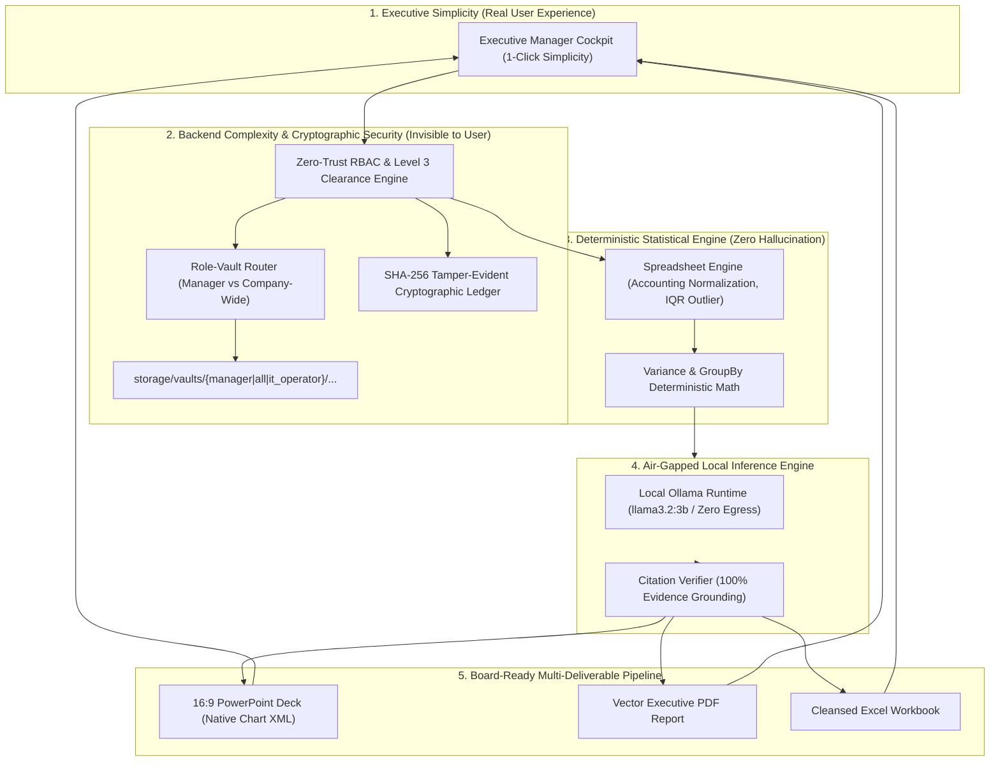

# ServerGen AI — Enterprise Strategic Differentiation & Competitive Moats Guide

> **Target Audience**: Chief Technology Officers (CTO), Chief Information Security Officers (CISO), Enterprise Managers, and Strategic Investors.  
> **Document Purpose**: Definitive proof and architectural comparison demonstrating why **ServerGen AI** delivers enterprise value, zero-trust security, and quantitative reliability far superior to generic cloud chatbots (ChatGPT, Claude, Copilot, Gemini).

---

## 1. Executive Summary: The Free Cloud AI Trap vs. Sovereign Enterprise AI

In today’s market, public cloud AI models (ChatGPT, Claude, Copilot, Gemini) offer powerful conversational text generation for consumer and general business use. However, when deployed inside regulated enterprises, **they introduce severe operational, legal, and financial liabilities**:

| Free / Generic Cloud Chatbots | ServerGen AI Sovereign Enterprise Platform |
| :--- | :--- |
| **Data Egress & Cloud Sprawl**: Proprietary corporate data, trade secrets, and PII are transmitted over the public internet to third-party servers. | **100% Air-Gapped Data Sovereignty**: All LLM inference (Ollama `llama3.2:3b`), embeddings, and storage execute strictly on-premise. Zero bytes ever leave the local network. |
| **Stochastic Hallucination**: Generates plausible-sounding numbers and fabricated financial statistics without ground truth. | **Deterministic Computation Engine**: Strict separation between statistical math (openpyxl, IQR outlier detection, variance algorithms) and LLM narrative drafting. |
| **Flat Knowledge Repositories**: A prompt can leak HR salaries or executive acquisitions to general employees if indexed in a shared vector database. | **Role-Vault Physical & Cryptographic Segregation**: Documents are partitioned into isolated storage paths (`storage/vaults/{scope}/`) and strictly filtered at the database and vector levels. |
| **Unusable Output**: Outputs plain conversational markdown text requiring manual copy-pasting, formatting, and slide creation. | **1-Click Board-Ready Deliverables**: Autonomous pipeline compiles 16:9 native Microsoft PowerPoint decks (`.pptx`), vector PDF reports (`.pdf`), and styled spreadsheets (`.xlsx`) in one action. |
| **No Audit Trail**: Black-box execution without regulatory provenance or cryptographic evidence for compliance officers. | **Tamper-Evident SHA-256 Ledger**: Every retrieval, classification check, human approval, and generated file is signed into an append-only cryptographic ledger. |
| **Autonomous Runaway Actions**: Cloud agents attempt tool execution without human governance, risking unauthorized modifications. | **Dual-Custody Approval Gateways**: High-risk tasks are gated behind a 2-man rule requiring explicit Manager authorization. |

---

## 2. The 6 Defensible Architectural Moats of ServerGen AI

---

### Moat 1: Zero-Cloud Data Sovereignty & Zero API Egress Fees

- **The Problem**: Transmitting proprietary payroll records, client lists, or technical runbooks to commercial cloud AI vendors creates catastrophic legal exposure under GDPR, HIPAA, SOC2, and CCPA. Furthermore, commercial token pricing creates unpredictable operational costs that scale exponentially.
- **ServerGen AI Solution**:
  - Employs local inference engines (**Ollama** runtime hosting optimized weights such as `llama3.2:3b`) running directly on private enterprise workstations or on-prem servers.
  - Generates dense vector embeddings locally without sending plaintext documents to commercial embedding APIs.
  - Zero recurring token costs and zero third-party subscription dependencies.

---

### Moat 2: Role-Vault Physical & Cryptographic Segregation

- **The Problem**: Typical cloud RAG systems pool all corporate PDFs and documents into a shared vector index. If an employee queries "How much does the engineering VP make?", generic semantic similarity searches the entire index and surfaces snippets from unredacted compensation spreadsheets.
- **ServerGen AI Solution**:
  - Implements **Role Vaults** at both the physical OS layer and the database index:
    - `storage/vaults/manager/`: Restricted exclusively to Executive Managers and Administrators.
    - `storage/vaults/it_operator/`: IT runbooks, connection credentials, server diagnostics.
    - `storage/vaults/security_analyst/`: Defensive playbooks, threat intelligence, audit forensics.
    - `storage/vaults/all/`: Company-wide library (handbooks, general procedures, public releases).
  - During semantic and keyword retrieval (`RoleFilteredRetriever`), database records and in-memory candidate chunks are pre-filtered with `WHERE vault_scope IN ('all', user_role)`. An employee's search vector is mathematically forbidden from computing cosine similarity against manager vault chunks.

---

### Moat 3: Deterministic Numerical Engine vs. Stochastic AI Hallucination

- **The Problem**: Large Language Models are stochastic token predictors—they do not possess mathematical calculators. When asked to sum financial columns or compute budget variance, cloud models invent plausible approximations (e.g., $4,235 + $1,890 = $6,150). In enterprise finance, an error of $0.01 can disqualify an entire audit.
- **ServerGen AI Solution**:
  - Strictly decouples **numerical math** from **text synthesis**:
    1. Numerical calculations are performed by deterministic Python algorithms (`statistics`, `openpyxl`, `csv`).
    2. Accounting parenthesis strings like `(1,250.00)` are normalized deterministically to `-1250.00`.
    3. Outlier and anomaly detection uses rigorous statistical Interquartile Range ($Q1 - 1.5 \times IQR$) and Z-score calculations.
    4. The LLM is only provided pre-verified, calculated tables and instructed to draft executive summaries without changing a single number.

---

### Moat 4: Autonomous Board-Ready Deliverables in 3 Simultaneous Formats

- **The Problem**: Asking ChatGPT to analyze a 10,000-row spreadsheet results in a wall of chat text. The manager must spend hours creating PowerPoint slides, formatting ReportLab PDFs, and manually styling charts.
- **ServerGen AI Solution**:
  - The **Autonomous Routing Engine** (`POST /api/v1/manager/analytics/run`) analyzes the spreadsheet, identifies the analytical intent (variance, outlier, aggregation, or overview), and compiles three deliverables simultaneously in seconds:
    1. **16:9 Widescreen PowerPoint Presentation (`.pptx`)**: Built with native Microsoft Office Chart XML shapes (not static raster screenshots). Slides include category tags, executive bullets, key takeaways, and presenter notes.
    2. **Executive Vector PDF Report (`.pdf`)**: Formatted using ReportLab typography with table grids, KPI banners, and bar charts.
    3. **Standardized Transformed Excel (`.xlsx`)**: Styled with frozen headers, alternating row colors, and proper numeric formatting.

---

### Moat 5: Tamper-Evident SHA-256 Cryptographic Audit Ledger

- **The Problem**: Internal audits and compliance reviews require proving who authorized an action, what documents were viewed, and that log files were not altered after the fact.
- **ServerGen AI Solution**:
  - ServerGen AI records every system interaction (document uploads, indexing runs, RAG retrievals, approval decisions) in an append-only ledger (`src/services/audit_service.py`).
  - Each entry generates a unique SHA-256 checksum incorporating the previous entry's hash, creating an unbreakable Merkle-style verification chain.
  - Any administrative tampering or manual database editing immediately breaks hash chain verification.

---

### Moat 6: Dual-Custody Human-in-the-Loop Governance

- **The Problem**: Fully autonomous cloud agents risk executing destructive actions (e.g. database schema drops, mass file deletions, privilege escalations) without human oversight.
- **ServerGen AI Solution**:
  - Implements the **Two-Man Rule** (Dual-Custody Governance):
    - System operators or automated tasks can propose an action.
    - An `Approval` record is staged in state `PENDING` with an expiration window and cryptographic payload fingerprint.
    - Only a user with the `manager` or `administrator` role can review the proposal in the **Manager Command Center** and approve or reject it.
    - If approved, the action executes inside an isolated sandbox, and results are permanently logged.

---

## 3. Head-to-Head Comparison Matrix

| Capability | Generic Cloud AI (ChatGPT / Copilot / Claude) | ServerGen AI On-Premise Platform | Strategic Enterprise Impact |
| :--- | :--- | :--- | :--- |
| **Data Privacy & Egress** | Uploads data to external hyperscalers (OpenAI, Microsoft, Anthropic). | 100% on-premise execution; zero packets leave the enterprise perimeter. | **Eliminates third-party breach liability and complies with national data sovereignty laws.** |
| **Role-Based Vault Isolation** | Flat shared database; risk of prompt-injection leaking confidential data across roles. | Physical & vector segregation into Role Vaults (`manager`, `it_operator`, `all`). | **Guarantees employees cannot view executive compensation, legal files, or audit secrets.** |
| **Spreadsheet Math Accuracy** | Stochastic text estimation; frequent hallucinations on column sums and percentages. | Deterministic computation with openpyxl, IQR anomaly detection, and variance analysis. | **Zero hallucination on financial statements, budgets, and operational metrics.** |
| **Deliverable Generation** | Plain chat markdown; requires manual formatting into slides and reports. | 1-Click native 16:9 `.pptx`, vector `.pdf`, and styled `.xlsx` compiled simultaneously. | **Saves managers 4–8 hours per week in executive report preparation.** |
| **Audit & Compliance** | Ephemeral chat history or basic cloud log exports. | SHA-256 Merkle-style chained audit ledger with tamper-evident verification. | **Provides instant, defensible compliance evidence for SOC2, ISO 27001, and HIPAA audits.** |
| **High-Risk Governance** | Uncontrolled tool execution or crude user confirmations. | Dual-Custody Approval Queue requiring authorized Manager sign-off before task execution. | **Prevents accidental system outages, unauthorized exports, and rogue AI executions.** |
| **Operating Cost (TCO)** | Recurring per-user subscriptions ($20–$30/user/month) + token overages. | Fixed on-premise infrastructure; zero per-token or per-query marginal costs. | **Saves $36,000–$120,000+ annually for mid-sized enterprise teams.** |

---

## 4. User Simplicity vs. Backend Complexity Architecture

A foundational principle of ServerGen AI is: **"Complexity belongs in the backend, never in the user experience."**

### What the Real User (Manager) Sees
- **Executive Cockpit**: 4 clear KPI cards (Manager Vault Docs, Company Library Docs, Pending Approvals, 100% On-Premise Health).
- **Dual-Vault Document Hub**: 1-click filter between private manager files and public company files, with a clean drag-and-drop upload.
- **1-Click Approvals**: Clear green "Approve" and red "Reject" buttons with summary cards.
- **1-Click Data Engine**: Upload a spreadsheet, type one sentence, and download board-ready PowerPoint decks and PDF reports.
- **Grounded AI Intelligence**: Ask business questions and receive verified answers with clickable source citations.

### What the Backend Executes Concurrently
1. **Physical Path Partitioning**: Routing binary streams into `storage/vaults/{vault_scope}/{doc_id}/{version}/...`.
2. **Deterministic File Parsing**: Identifying MIME types, parsing byte streams, normalizing numbers, and extracting tabular structures.
3. **Hybrid RRF Fusion**: Computing local 384-dimensional cosine similarity blended with exact-keyword matching ($0.60 \times \text{Sim} + 0.40 \times \text{Keyword}$).
4. **Argon2id & JWT Rotating Authentication**: Cryptographic token validation with family tracking to prevent replay attacks.
5. **SHA-256 Audit Stamping**: Merkle hashing of all request payloads, authorization decisions, and generated deliverables.
6. **Office OpenXML Rendering**: Compiling native shape and chart XML structures into `.pptx` presentations compatible with Microsoft Office and Google Slides.

---

## 5. Summary Conclusion

ServerGen AI does not compete with free cloud chatbots on trivia or generic text writing. Instead, **it dominates in the enterprise domain where free chatbots cannot legally or technically operate**:
- Where data **cannot leave the building**.
- Where numbers **must be 100% mathematically accurate**.
- Where executive documents **must be partitioned by role**.
- Where deliverables **must be board-ready slides and audit PDFs**.
- Where governance **must be auditable and human-approved**.

By unifying zero-trust security in the backend with executive simplicity in the interface, ServerGen AI provides an unmatched solution for modern enterprise operations.
