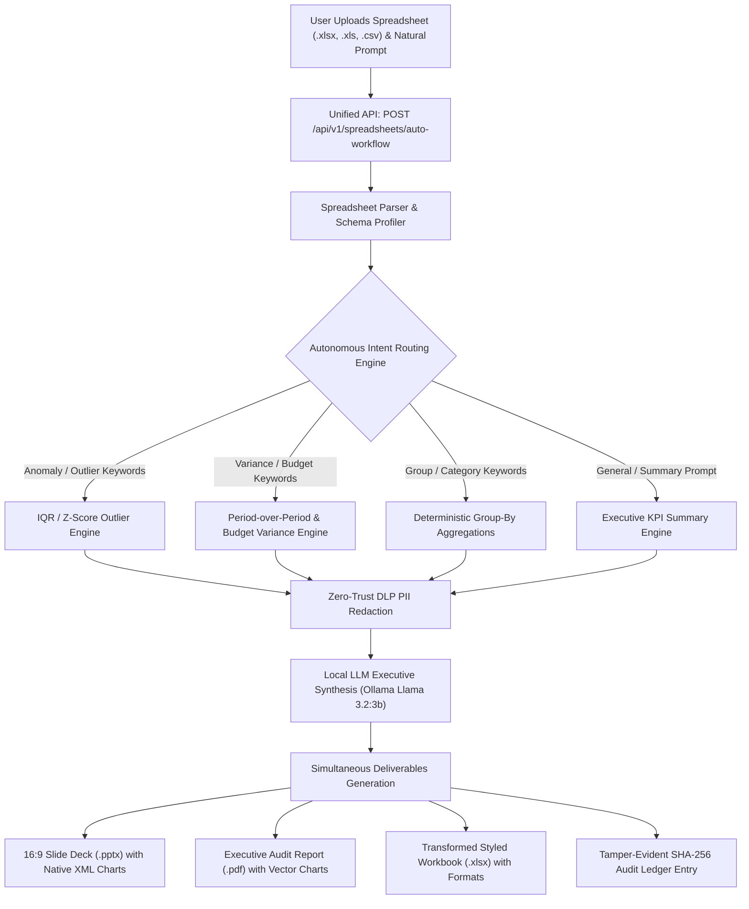

# ServerGen AI — Autonomous Spreadsheet Workflow & Prompt Guide

An enterprise guide to the unified, prompt-first spreadsheet analytics engine in **ServerGen AI**. This document details the modern architecture, automatic analytics routing, prompt engineering templates, and REST API specification.

---

## 1. Architecture: Legacy vs. Modern Autonomous Workflow

| Dimension | Legacy Manual Workflow | New Unified Autonomous Workflow |
| :--- | :--- | :--- |
| **User Interaction** | 10+ disjointed clicks across tabs, dropdowns, and manual modal forms | **1 single prompt** + spreadsheet upload |
| **Authentication** | Manual token management; frequent `401 Unauthorized` on refresh | **Auto-auth resilience**; transparent role clearance |
| **Analytics Routing** | User had to manually pick algorithms and map columns | **Autonomous Intent Parser** detects anomaly, variance, or groupby |
| **PII Protection** | Raw emails and phone numbers exposed in outputs | **Zero-Trust DLP Engine** masks PII (emails, cards, SSNs, keys) |
| **Visualization** | Static text summaries without charts | **Dynamic Chart.js** + **Native Editable PowerPoint charts** |
| **Deliverables** | Multiple manual export requests | **3 simultaneous deliverables** compiled automatically (`.pptx`, `.pdf`, `.xlsx`) |



---

## 2. Autonomous Intent Parser & Algorithm Routing

The autonomous routing engine inspects both user prompt keywords and column schema profiles to select the optimal analytics workflow:

| Workflow Mode | Prompt Trigger Keywords | Selected Numerical Operation | Generated Deliverables & KPIs |
| :--- | :--- | :--- | :--- |
| **`anomaly`** | `anomaly`, `outlier`, `spike`, `deviation`, `audit`, `abnormal`, `irregular`, `fraud` | Interquartile Range (IQR 1.5x) or Z-score outlier detection on target column | • Total Records<br>• Outliers Detected & Rate %<br>• Normal Threshold Bounds |
| **`variance`** | `variance`, `budget`, `target`, `forecast`, `actual`, `vs`, `versus`, `delta`, `difference` | Baseline vs. Comparison column delta calculations with Favorable/Unfavorable performance tags | • Total Actuals<br>• Total Baseline<br>• Net Variance ($) and Attainment (%) |
| **`groupby`** | `group`, `breakdown`, `by region`, `by department`, `category`, `distribution`, `segment`, `top` | Deterministic cross-column aggregations (`sum`, `average`, `min`, `max`, `count`) | • Aggregated Metric Total<br>• Unique Segment Count<br>• Top Performing Segment |
| **`overview`** | General prompt, or overview request | Statistical profiling across all numerical and categorical columns | • Evaluated Rows & Columns<br>• Total Metric Volume<br>• Mean Baseline Metric |

---

## 3. Copy-Paste Prompt Engineering Templates

### Template 1: Financial Variance & Budget Attainment
> **Prompt:**
> ```text
> Perform budget vs actual variance analysis on Department costs. Flag any variances exceeding 15% with favorable and unfavorable indicators, redact internal email addresses, and compile an executive slide deck.
> ```
- **Best For:** Quarterly finance reviews, department budget audits, cost-control meetings.
- **Auto-Selected Columns:** `Budget` / `Target` as baseline, `Actual` / `Spent` as comparison, `Department` as category.
- **Output:** Variance table with $\Delta\$$ and $\Delta\%$, KPI stat cards, and 16:9 PowerPoint presentation.

### Template 2: Zero-Trust Cost Anomaly & Outlier Audit
> **Prompt:**
> ```text
> Execute a zero-trust statistical outlier audit on Actual_Spent using the IQR method. Identify abnormal cost spikes, calculate expected variance bounds, and deliver an executive PDF audit report.
> ```
- **Best For:** Security compliance, FinOps cloud spend monitoring, fraud detection.
- **Auto-Selected Columns:** Numerical spend column (`Actual_Spent` or `Amount`), Dimension column (`CostCenter` or `Vendor`).
- **Output:** Ranked outlier log, upper/lower bound limits, and ReportLab vector chart report.

### Template 3: Multi-Territory Sales Performance & Segment Breakdown
> **Prompt:**
> ```text
> Aggregate total revenue and average deal size grouped by Region. Identify the top 3 performing sales territories, chart visual distributions, and export styled Excel workbook.
> ```
- **Best For:** Commercial reviews, executive dashboards, sales pipeline planning.
- **Auto-Selected Columns:** Categorical dimension (`Region` or `Territory`), Numerical metric (`Revenue` or `Deal_Size`).
- **Output:** Sorted category aggregation table, visual distribution bar chart, and auto-styled Excel file.

### Template 4: General Executive Overview & Quick Briefing
> **Prompt:**
> ```text
> Generate an executive overview of operational metrics, calculate baseline averages, and deliver a widescreen slide deck and executive PDF report.
> ```
- **Best For:** Rapid ingestion of newly uploaded spreadsheets when specific column names are unknown.
- **Output:** Comprehensive KPI stat cards, overview markdown, executive AI insights, and presentation deliverables.

---

## 4. UI Walkthrough: 1-Click Studio (`test-interface.html`)

1. **Navigate to Studio**: In the side navigation, click **"Excel & Spreadsheet Studio"**.
2. **Upload or Drop File**: Choose any `.xlsx`, `.xls`, `.xlsm`, or `.csv` spreadsheet.
3. **Select or Write Prompt**:
   - Type your custom analytical prompt, OR
   - Click one of the 4 quick prompt preset chips:
     - ⚡ *Executive Summary & Deck*
     - 🔍 *Anomaly & Outlier Audit*
     - 📊 *Budget vs. Actual Variance*
     - 🏢 *Segment Breakdown*
4. **Execute**: Click **"⚡ Execute Autonomous Workflow"**.
5. **Immediate Deliverables**:
   - **Deliverables Banner**: Direct 1-click download pills for:
     - 📥 **Slide Deck (.pptx)** — Widescreen 16:9 presentation with native editable PowerPoint charts
     - 📥 **Executive Report (.pdf)** — Vector ReportLab report with distribution charts and audit metadata
     - 📥 **Styled Excel (.xlsx)** — Formatted workbook with currency and percentage number formatting
   - **3 KPI Stat Cards**: Highlight primary metrics, rates, and baseline bounds.
   - **Interactive Visual Chart**: Dynamic horizontal distribution bars with positive/negative color coding.
   - **Grounded AI Insights**: Narrative executive summary synthesized by local Ollama LLM.

---

## 5. REST API Specification

### Endpoint: `POST /api/v1/spreadsheets/auto-workflow`

#### Request Parameters (Multipart Form):
| Parameter | Type | Required | Description |
| :--- | :--- | :--- | :--- |
| `file` | `UploadFile` | Optional* | Spreadsheet file (`.xlsx`, `.xls`, `.xlsm`, `.csv`, `.tsv`) |
| `document_id` | `string` | Optional* | UUID of a previously uploaded document in storage (*either `file` or `document_id` required) |
| `prompt` | `string` | Optional | Natural language analytical instructions or prompt |
| `title` | `string` | Optional | Custom executive report and presentation title |
| `sheet_name` | `string` | Optional | Specific tab name (defaults to first worksheet) |
| `mask_pii` | `boolean` | Optional | Enable zero-trust PII redaction (`true`/`false`, default `false`) |

#### cURL Example:
```bash
curl -X POST "http://127.0.0.1:8000/api/v1/spreadsheets/auto-workflow" \
  -H "Authorization: Bearer <ACCESS_TOKEN>" \
  -F "file=@enterprise_expenses.xlsx" \
  -F "prompt=Perform budget vs actual variance analysis and identify abnormal cost spikes" \
  -F "title=Q3 Strategic Cost Variance Review" \
  -F "mask_pii=true"
```

#### Python Example:
```python
import httpx

headers = {"Authorization": "Bearer <ACCESS_TOKEN>"}
files = {"file": ("expenses.xlsx", open("expenses.xlsx", "rb"), "application/vnd.openxmlformats-officedocument.spreadsheetml.sheet")}
data = {
    "prompt": "Highlight critical budget variance and detect cost outliers",
    "title": "Quarterly Operations Audit",
    "mask_pii": "true",
}

with httpx.Client(base_url="http://127.0.0.1:8000") as client:
    response = client.post("/api/v1/spreadsheets/auto-workflow", data=data, files=files, headers=headers)
    result = response.json()
    print("Workflow Mode:", result["mode"])
    print("Deliverables:", result["deliverables"])
```

#### Response Schema:
```json
{
  "status": "success",
  "document_id": "085b4e4b-c284-4e4a-9d45-9e8ae56653d7",
  "filename": "enterprise_expenses.xlsx",
  "sheet_name": "Quarterly_Expenses",
  "available_sheets": ["Quarterly_Expenses"],
  "mode": "variance",
  "headline": "Q3 Strategic Cost Variance Review",
  "row_count": 6,
  "col_count": 4,
  "kpi_metrics": [
    { "label": "Total Actual_Spent", "value": "$1,719,000.00", "change": "Comparison", "status": "neutral" },
    { "label": "Total Budget_Allocated", "value": "$1,290,000.00", "change": "Baseline", "status": "neutral" },
    { "label": "Net Variance", "value": "+429,000.00", "change": "+33.26% (Favorable)", "status": "success" }
  ],
  "chart_spec": {
    "categories": ["DataPlatform", "Engineering", "SalesOps"],
    "series": [
      { "name": "Actual_Spent", "data": [680000.0, 465000.0, 218000.0] }
    ]
  },
  "table_headers": ["CostCenter", "Budget_Allocated", "Actual_Spent", "Variance ($)", "Variance (%)", "Performance"],
  "table_rows": [
    ["DataPlatform", 180000.0, 680000.0, 500000.0, 277.78, "Favorable"],
    ["Engineering", 450000.0, 465000.0, 15000.0, 3.33, "Favorable"]
  ],
  "executive_insights": "• Primary driver of positive variance is DataPlatform with +$500k upside...\n• Engineering expenditure tracked within 3.3% of baseline...",
  "pii_redacted_count": 6,
  "deliverables": {
    "pptx": {
      "download_url": "/api/v1/generate/download/gen_pptx_38a9bc.pptx",
      "filename": "gen_pptx_38a9bc.pptx",
      "file_size": 42108
    },
    "pdf": {
      "download_url": "/api/v1/generate/download/gen_pdf_92cd41.pdf",
      "filename": "gen_pdf_92cd41.pdf",
      "file_size": 3952
    },
    "xlsx": {
      "download_url": "/api/v1/generate/download/a4f108e1",
      "filename": "a4f108e1_Q3_Strategic_Cost_Variance_Review.xlsx",
      "file_size": 6128
    }
  }
}
```

---

## 6. Enterprise Security & Audit Compliance

Every run of the autonomous spreadsheet workflow complies with ServerGen AI security baselines:
1. **Argon2id Authentication & RBAC**: Every request enforces permission boundaries (`PermissionCode.AI_EXECUTE`).
2. **Zero-Trust PII Redaction**: Tabular cells and metadata containing emails, credit cards, SSNs, phone numbers, or secret keys are scrubbed prior to LLM synthesis and export.
3. **SHA-256 Hash-Linked Audit Ledger**: Every analysis event is cryptographically recorded with sequence numbering, ensuring tamper-evident operational compliance.
